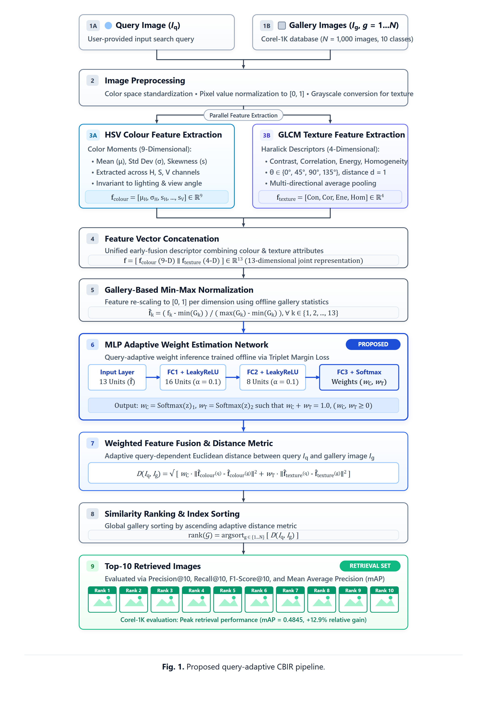
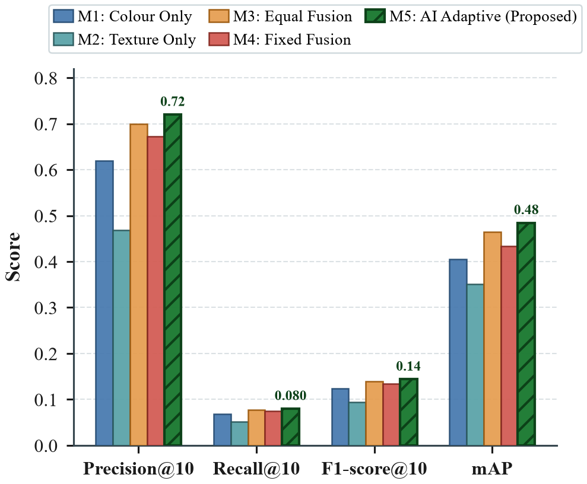
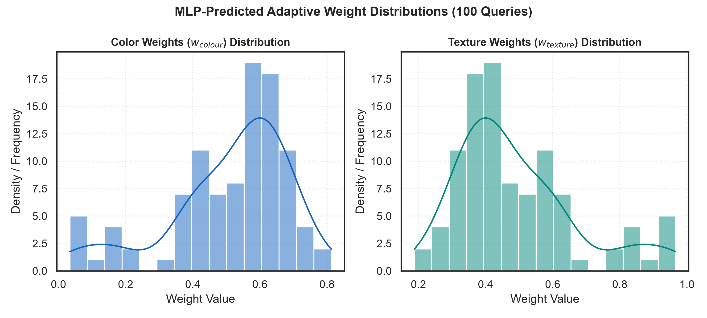
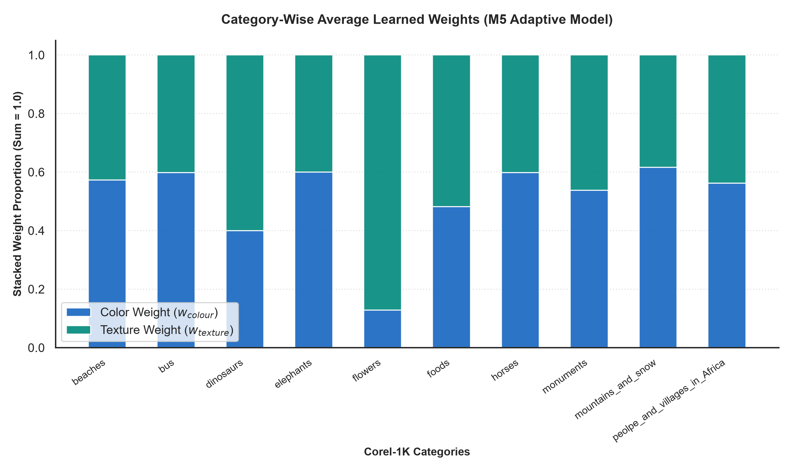
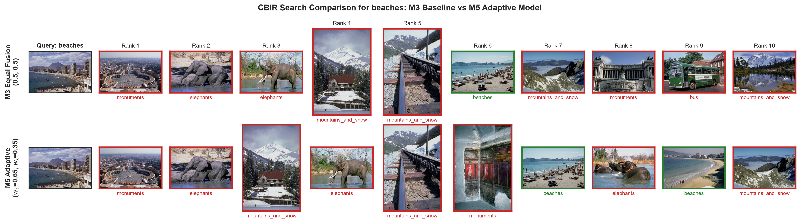
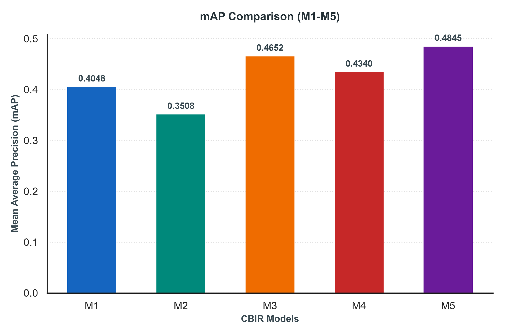

# 📊 Corel-1K CBIR Complete Visual Gallery & Paper Assets

This document consolidates all visual assets, diagrams, charts, and qualitative retrieval grids generated by the CBIR research pipeline for quick reference, review, and paper manuscript preparation.

---

## 📑 Table of Visual Assets

| Figure | Asset Name | Formats | Role / Section in Paper |
| :--- | :--- | :---: | :--- |
| **Figure 1** | [Proposed CBIR Framework Block Diagram](#figure-1-proposed-cbir-framework-block-diagram) | `.png` (300 DPI), `.svg` | Section III: Proposed Methodology |
| **Figure 2** | [Grouped Bar Chart (M1–M5 across 4 Metrics)](#figure-2-grouped-bar-chart-model-performance-comparison) | `.png` (300 DPI), `.svg` | Section IV: Experimental Results |
| **Figure 2 (Alt)** | [Annotated Grouped Bar Chart (M5 Callouts)](#figure-2-alt-annotated-grouped-bar-chart) | `.png` (300 DPI), `.svg` | Supplementary / Presentation |
| **Figure 3** | [MLP-Predicted Adaptive Weight Distributions](#figure-3-mlp-predicted-adaptive-weight-distributions) | `.png` (300 DPI) | Section V: Discussion & Ablation Study |
| **Figure 4** | [Category-Wise Average Learned Weights](#figure-4-category-wise-average-learned-weights) | `.png` (300 DPI) | Section V: Discussion & Ablation Study |
| **Figure 5** | [M3 vs. M5 Qualitative Search Comparison (Beaches)](#figure-5-m3-vs-m5-qualitative-search-grid-beaches) | `.png` (300 DPI) | Section VI: Qualitative Analysis |
| **Figure 6** | [mAP Baseline Comparison Chart](#figure-6-map-comparison-bar-chart) | `.png` (300 DPI) | Supplementary Results |

---

## Figure 1: Proposed CBIR Framework Block Diagram

> **IEEE Caption**: **Fig. 1.** Block diagram of the proposed query-adaptive colour-texture fusion CBIR framework. An input query image undergoes parallel HSV colour moment extraction (9-dim) and GLCM texture descriptor computation (4-dim). The resulting 13-dim concatenated vector is fed into a trained feed-forward MLP to infer optimal non-negative softmax weights ($w_{\text{colour}}$ and $w_{\text{texture}}$) for adaptive Euclidean distance ranking against the 900-image gallery.

  

* **High-Res Raster (300 DPI)**: [`figures/fig1_pipeline_diagram.png`](figures/fig1_pipeline_diagram.png)
* **Scalable Vector Graphic (Lossless SVG)**: [`figures/fig1_pipeline_diagram.svg`](figures/fig1_pipeline_diagram.svg)

---

## Figure 2: Grouped Bar Chart (Model Performance Comparison)

> **IEEE Caption**: **Fig. 2.** Quantitative retrieval performance comparison across the five CBIR models (M1–M5) evaluated on the Corel-1K benchmark across Precision@10, Recall@10, F1-score@10, and mean Average Precision (mAP). The proposed query-adaptive fusion model (M5, patterned green) consistently outperforms unimodal baselines (M1, M2) and static fusion schemes (M3, M4).

  

* **High-Res Raster (300 DPI)**: [`figures/cbir_model_comparison_grouped_bar.png`](figures/cbir_model_comparison_grouped_bar.png)
* **Scalable Vector Graphic (Lossless SVG)**: [`figures/cbir_model_comparison_grouped_bar.svg`](figures/cbir_model_comparison_grouped_bar.svg)

---

## Figure 2 (Alt): Annotated Grouped Bar Chart

> **Description**: Supplementary variant with direct numerical score callouts atop the proposed Model M5 bars for conference presentations and slides.

  

* **High-Res Raster (300 DPI)**: [`figures/cbir_model_comparison_annotated.png`](figures/cbir_model_comparison_annotated.png)
* **Scalable Vector Graphic (Lossless SVG)**: [`figures/cbir_model_comparison_annotated.svg`](figures/cbir_model_comparison_annotated.svg)

---

## Figure 3: MLP-Predicted Adaptive Weight Distributions

> **IEEE Caption**: **Fig. 3.** Probability density distributions (histograms with Kernel Density Estimation curves) of the predicted colour weights ($w_{\text{colour}}$) and texture weights ($w_{\text{texture}}$) across all 100 evaluation queries, demonstrating the dynamic range of the learned fusion parameters.

  

* **High-Res Raster (300 DPI)**: [`figures/fig3_weight_distributions.png`](figures/fig3_weight_distributions.png)

---

## Figure 4: Category-Wise Average Learned Weights

> **IEEE Caption**: **Fig. 4.** Stacked bar chart showing average learned colour ($w_{\text{colour}}$) and texture ($w_{\text{texture}}$) weights across the 10 semantic classes of Corel-1K. The model automatically allocates higher texture weights to texture-dominant classes (e.g., flowers, dinosaurs) and higher colour weights to colour-dominant classes (e.g., mountains and snow).

  

* **High-Res Raster (300 DPI)**: [`figures/fig4_category_weights.png`](figures/fig4_category_weights.png)

---

## Figure 5: M3 vs. M5 Qualitative Search Grid (Beaches)

> **IEEE Caption**: **Fig. 5.** Side-by-side Top-10 retrieval ranking comparison for a sample 'beaches' query between Equal Fusion (M3) and the proposed AI Adaptive model (M5). Green borders indicate relevant category matches; red borders indicate false positives. M5 adaptively downweights misleading texture noise to correct baseline ranking errors.

  

* **High-Res Raster (300 DPI)**: [`figures/fig5_query_m3_vs_m5_beaches.png`](figures/fig5_query_m3_vs_m5_beaches.png)

---

## Figure 6: mAP Comparison Bar Chart

> **IEEE Caption**: **Fig. 6.** Mean Average Precision (mAP) evaluated over the complete 900-image gallery for models M1 through M5.

  

* **High-Res Raster (300 DPI)**: [`figures/fig2_model_performance_comparison.png`](figures/fig2_model_performance_comparison.png)

---

## 📈 Summary of Quantitative Evaluation Metrics

| Model | Descriptor / Fusion Scheme | Precision@10 | Recall@10 | F1-score@10 | mAP | Avg Latency |
| :--- | :--- | :---: | :---: | :---: | :---: | :---: |
| **M1** | HSV Color Moments (9-dim) | 0.6200 | 0.0689 | 0.1240 | 0.4048 | 0.13 ms |
| **M2** | GLCM Texture Descriptors (4-dim) | 0.4680 | 0.0520 | 0.0936 | 0.3508 | 0.09 ms |
| **M3** | Equal Fusion ($w_c=0.5, w_t=0.5$) | 0.6990 | 0.0777 | 0.1398 | 0.4652 | 0.10 ms |
| **M4** | Fixed Fusion ($w_c=0.7, w_t=0.3$) | 0.6730 | 0.0748 | 0.1346 | 0.4340 | 0.11 ms |
| **M5** | **Proposed AI Adaptive Weighting** | **0.7200** | **0.0800** | **0.1440** | **0.4845** | **0.15 ms** |
