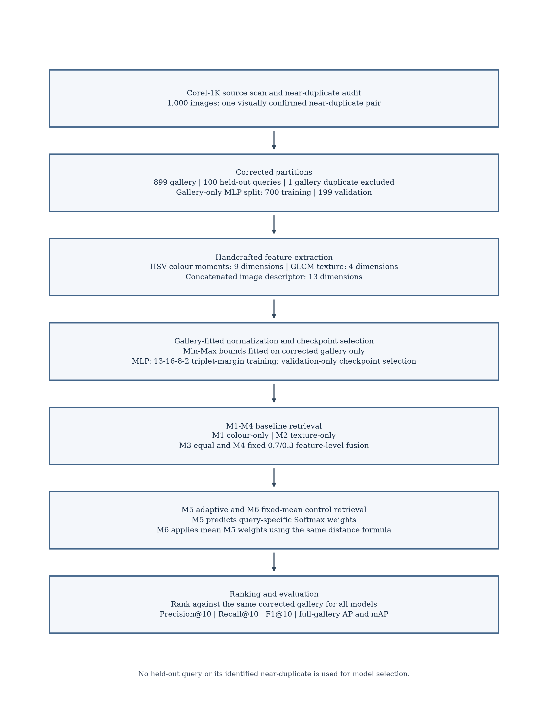
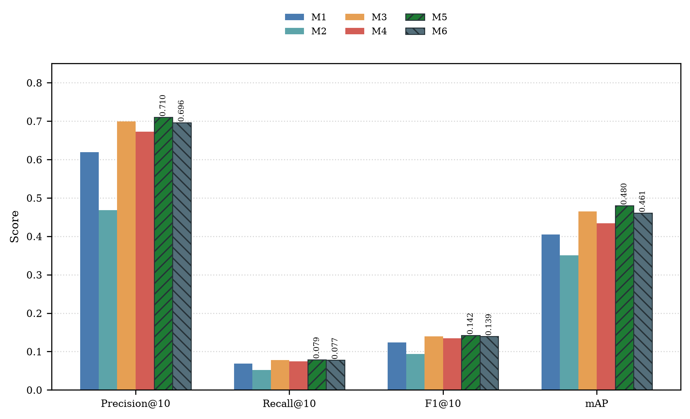
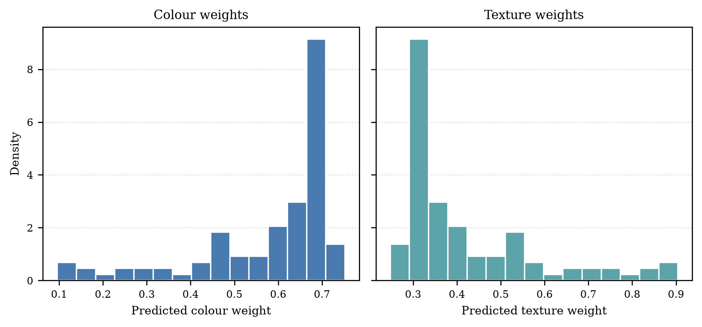
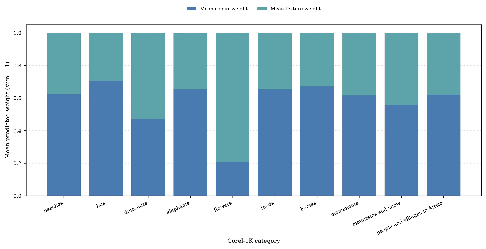
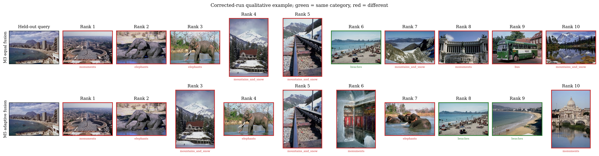
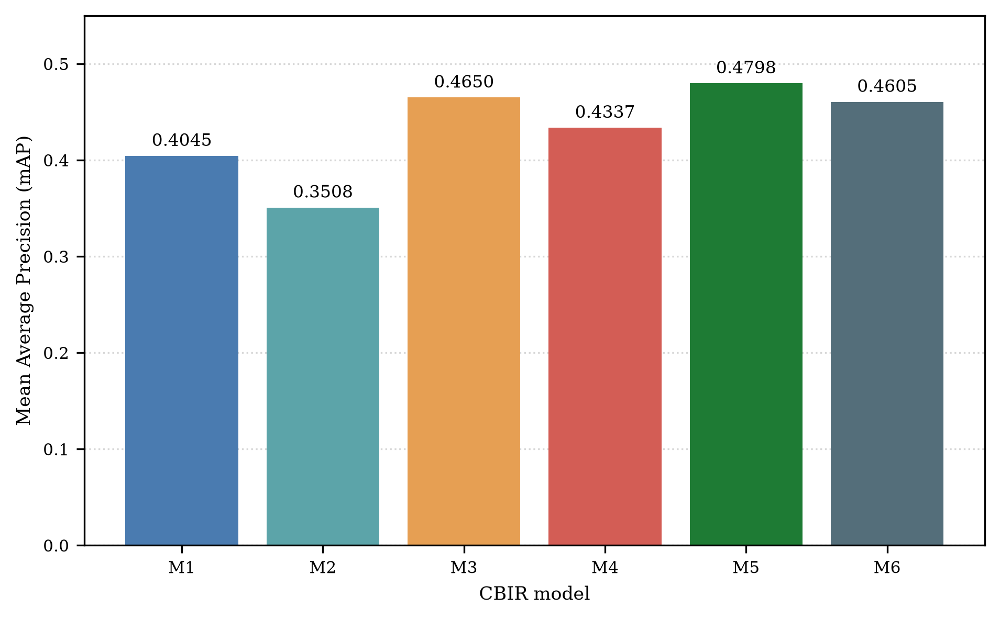
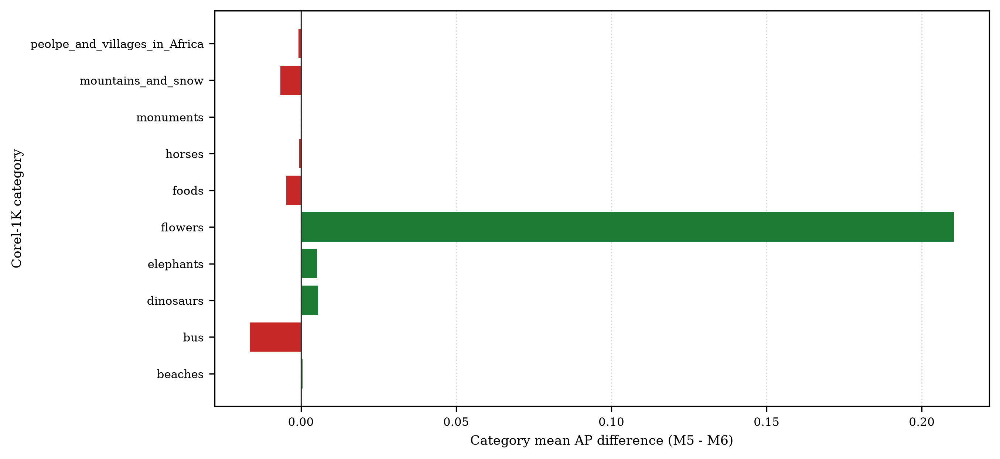

# 📊 Corel-1K CBIR Complete Visual Gallery & Paper Assets

This document consolidates all visual assets, diagrams, charts, and qualitative retrieval grids generated by the CBIR research pipeline for quick reference, review, and paper manuscript preparation.

---

## 📑 Table of Visual Assets

| Figure | Asset Name | Formats | Role / Section in Paper |
| :--- | :--- | :---: | :--- |
| **Figure 1** | [Proposed CBIR Framework Block Diagram](#figure-1-proposed-cbir-framework-block-diagram) | `.png` (300 DPI), `.svg` | Section III: Proposed Methodology |
| **Figure 2** | [Grouped Bar Chart (M1–M6 across 4 Metrics)](#figure-2-grouped-bar-chart-model-performance-comparison) | `.png` (300 DPI), `.svg` | Section IV: Experimental Results |
| **Figure 2 (Alt)** | [Annotated Grouped Bar Chart (M5/M6 Callouts)](#figure-2-alt-annotated-grouped-bar-chart) | `.png` (300 DPI), `.svg` | Supplementary / Presentation |
| **Figure 3** | [MLP-Predicted Adaptive Weight Distributions](#figure-3-mlp-predicted-adaptive-weight-distributions) | `.png` (300 DPI) | Section V: Discussion & Ablation Study |
| **Figure 4** | [Category-Wise Average Learned Weights](#figure-4-category-wise-average-learned-weights) | `.png` (300 DPI) | Section V: Discussion & Ablation Study |
| **Figure 5** | [M3 vs. M5 Qualitative Search Comparison (Beaches)](#figure-5-m3-vs-m5-qualitative-search-grid-beaches) | `.png` (300 DPI) | Section VI: Qualitative Analysis |
| **Figure 6** | [mAP Baseline Comparison Chart](#figure-6-map-comparison-bar-chart) | `.png` (300 DPI) | Supplementary Results |

---

## Figure 1: Proposed CBIR Framework Block Diagram

> **IEEE Caption**: **Fig. 1.** Block diagram of the query-adaptive colour-texture fusion CBIR framework. An input query image undergoes parallel HSV colour moment extraction (9-dim) and GLCM texture descriptor computation (4-dim). The resulting 13-dim vector is fed into the trained feed-forward MLP to predict non-negative Softmax weights ($w_{\text{colour}}$ and $w_{\text{texture}}$) for adaptive distance ranking against the corrected 899-image gallery. The gallery excludes `training_set/horses/761.jpg`, a visually confirmed near-duplicate of the retained held-out query `training_set/horses/776.jpg`.

  

* **Corrected high-res raster (300 DPI)**: [`fig1_corrected_pipeline.png`](paper_results/corrected_corel_v1/assets_v4/fig1_corrected_pipeline.png)
* **Corrected vector graphic**: [`fig1_corrected_pipeline.svg`](paper_results/corrected_corel_v1/assets_v4/fig1_corrected_pipeline.svg)

---

## Figure 2: Grouped Bar Chart (Model Performance Comparison)

> **IEEE Caption**: **Fig. 2.** Quantitative retrieval performance comparison across six CBIR models (M1–M6) on the corrected Corel-1K split (899 gallery images and 100 held-out queries), using Precision@10, Recall@10, F1-score@10, and mAP. M5 is query-adaptive; M6 is the fixed mean-weight control using the M5 distance formula.

  

* **Corrected high-res raster (300 DPI)**: [`fig2_corrected_grouped_metrics.png`](paper_results/corrected_corel_v1/assets_v4/fig2_corrected_grouped_metrics.png)
* **Corrected vector graphic**: [`fig2_corrected_grouped_metrics.svg`](paper_results/corrected_corel_v1/assets_v4/fig2_corrected_grouped_metrics.svg)

---

## Figure 2 (Alt): Annotated Grouped Bar Chart

> **Description**: Supplementary variant with direct score callouts for M5 and M6.

  

* **Corrected high-res raster (300 DPI)**: [`fig2_corrected_grouped_metrics.png`](paper_results/corrected_corel_v1/assets_v4/fig2_corrected_grouped_metrics.png)
* **Corrected vector graphic**: [`fig2_corrected_grouped_metrics.svg`](paper_results/corrected_corel_v1/assets_v4/fig2_corrected_grouped_metrics.svg)

---

## Figure 3: MLP-Predicted Adaptive Weight Distributions

> **IEEE Caption**: **Fig. 3.** Histograms of M5-predicted colour and texture weights across the 100 held-out queries of the corrected Corel-1K evaluation. Weight variation is descriptive and does not by itself establish retrieval improvement.

  

* **Corrected high-res raster (300 DPI)**: [`fig3_corrected_weight_distributions.png`](paper_results/corrected_corel_v1/assets_v4/fig3_corrected_weight_distributions.png)
* **Corrected vector graphic**: [`fig3_corrected_weight_distributions.svg`](paper_results/corrected_corel_v1/assets_v4/fig3_corrected_weight_distributions.svg)

---

## Figure 4: Category-Wise Average Learned Weights

> **IEEE Caption**: **Fig. 4.** Stacked bars show mean M5-predicted colour ($w_{\text{colour}}$) and texture ($w_{\text{texture}}$) weights across the ten Corel-1K query categories in the corrected evaluation. These descriptive means do not, by themselves, establish retrieval improvement.

  

* **Corrected high-res raster (300 DPI)**: [`fig4_corrected_category_weights.png`](paper_results/corrected_corel_v1/assets_v4/fig4_corrected_category_weights.png)
* **Corrected vector graphic**: [`fig4_corrected_category_weights.svg`](paper_results/corrected_corel_v1/assets_v4/fig4_corrected_category_weights.svg)

---

## Figure 5: M3 vs. M5 Qualitative Search Grid (Beaches)

> **IEEE Caption**: **Fig. 5.** Top-10 rankings for the first held-out beaches query in the corrected saved ranking outputs, comparing equal fusion (M3) with query-adaptive M5. Green labels indicate same-category gallery images and red labels indicate different categories. This is one qualitative example, not evidence of general performance.

  

* **Corrected high-res raster (300 DPI)**: [`fig5_corrected_qualitative_example.png`](paper_results/corrected_corel_v1/assets_v4/fig5_corrected_qualitative_example.png)
* **Corrected vector graphic**: [`fig5_corrected_qualitative_example.svg`](paper_results/corrected_corel_v1/assets_v4/fig5_corrected_qualitative_example.svg)

---

## Figure 6: mAP Comparison Bar Chart

> **IEEE Caption**: **Fig. 6.** Mean Average Precision (mAP) evaluated over the corrected 899-image Corel-1K gallery for models M1-M6.

  

* **Corrected high-res raster (300 DPI)**: [`fig6_corrected_map.png`](paper_results/corrected_corel_v1/assets_v4/fig6_corrected_map.png)
* **Corrected vector graphic**: [`fig6_corrected_map.svg`](paper_results/corrected_corel_v1/assets_v4/fig6_corrected_map.svg)

## Figure 7: Category-level M5 versus M6 AP differences

> **IEEE Caption**: **Fig. 7.** Category mean AP differences (M5 minus M6) on the corrected Corel-1K query set. Positive and negative category results are both shown; the plot is descriptive and highlights the concentration of the aggregate difference.

  

---

## 📈 Summary of Quantitative Evaluation Metrics

| Model | Descriptor / Fusion Scheme | Precision@10 | Recall@10 | F1-score@10 | mAP | Avg Latency |
| :--- | :--- | :---: | :---: | :---: | :---: | :---: |
| **M1** | HSV Colour Moments (9-dim) | 0.6190 | 0.0689 | 0.1240 | 0.404462 | 0.082 ms |
| **M2** | GLCM Texture Descriptors (4-dim) | 0.4680 | 0.0521 | 0.0937 | 0.350816 | 0.073 ms |
| **M3** | Equal feature-level fusion ($w_c=0.5, w_t=0.5$) | 0.6990 | 0.0778 | 0.1400 | 0.465036 | 0.079 ms |
| **M4** | Fixed feature-level fusion ($w_c=0.7, w_t=0.3$) | 0.6730 | 0.0749 | 0.1348 | 0.433659 | 0.077 ms |
| **M5** | Query-adaptive distance-level weighting | 0.7100 | 0.0790 | 0.1422 | 0.479794 | 0.167 ms |
| **M6** | Fixed mean-weight distance-level control | 0.6960 | 0.0774 | 0.1394 | 0.460536 | 0.153 ms |

Results are from corrected run `run_20261025T130024Z`: 899 gallery images and 100 held-out queries; the MLP used 700 training and 199 validation images. The gallery-side `training_set/horses/761.jpg` was excluded after a SHA-256 and perceptual-hash audit and visual confirmation that it shared a scene with the retained query `training_set/horses/776.jpg`. Normalization and checkpoint selection excluded held-out queries. Timing is distance calculation plus ranking/sorting per query; feature extraction and MLP inference are measured separately and are not included in this table. M5 has a higher observed mAP than M6 on this split, but the difference is descriptive and is not evidence of statistical superiority.

Across five prespecified duplicate-group-disjoint seeds, the mean seed-level M5-M6 mAP difference was **+0.017592** (sample SD **0.004008**). This is descriptive: the five runs share gallery content and overlap in query identities (399 unique query images across 500 observations). The difference is category-dependent, driven primarily by flowers; foods and people/villages in Africa had negative category means in all five seeds. Do not treat the seed runs as independent replications.

### Oxford-IIIT Pet transfer (reported separately)

The frozen Corel-trained checkpoint was evaluated on the decontaminated Oxford-IIIT Pet official split, with breed as the relevance label. Corrected transfer mAP was M5 0.033882, M6 0.033683, and M7 0.033829. M5's top-10 precision, recall and F1 were lower than M6 and M7. This single-dataset transfer is not evidence of universal generalization; full metrics and limitations are in the separate Oxford transfer report.
